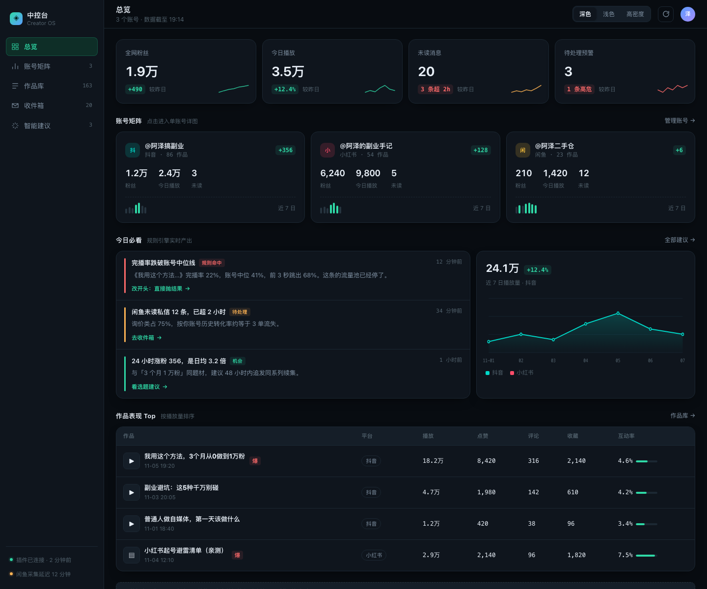

# 自媒体中控台 · Creator OS

把抖音、小红书、闲鱼的账号数据、作品表现、私信收进一块屏，
用**规则引擎 + 大模型**告诉你：下一条该发什么、为什么。

数据和登录态默认保存在本机。启用 AI 复盘或选题时，相关账号信息、作品标题和指标会发送给所配置的模型服务商（默认 DeepSeek）。

[**⬇ 下载 v0.1.4**](https://github.com/laq3416-lab/creator-console/releases/latest/download/creator-console-v0.1.4.zip) · [使用说明](docs/使用说明.md) · [架构](docs/00-产品与技术框架.md)



---

## 它能做什么

### 📊 数据采集

| 平台 | 入口 | 拿到的数据 |
|---|---|---|
| 抖音 | 创作者中心 | 播放、完播率、2 秒跳出、5 秒完播、涨粉、镜头节奏 |
| 小红书 | 创作服务平台 + 网页版 | 曝光、浏览、点赞、收藏、涨粉、封面点击率 |
| 闲鱼 | 网页版 | 商品清单、价格、状态 |

每个平台独立浏览器 Profile，互不覆盖。登录态只存在本机。

### 🔍 作品诊断

不只看数字，看**和同行的差距**：

- 完播率中位数 vs 同赛道爆款中位
- **镜头节奏**：用 ffmpeg 场景检测算出「平均镜头 67 秒 / 同行 17 秒」
- 2 秒跳出率、5 秒完播，判断钩子有没有效

### 🎯 爆款雷达

搜索同赛道关键词，按 **赞粉比（点赞 ÷ 粉丝数）**排序。
粉丝比你少、赞比你多的人，才是真正能学方法的对象。

在「智能建议」中点击新爆款卡片，可查看原视频链接、已有指标、镜头分析和模型拆解。模型基于采集到的数据生成建议，并未观看视频，需对照原视频核实。

### 💬 统一收件箱

三平台私信汇总，支持手动或按平台设置自动同步，并提供桌面通知。

| 平台 | 取数方式 |
|---|---|
| 闲鱼 | JSON 接口 |
| 小红书 | JSON 接口 |
| 抖音 | 读消息面板 DOM（它的 IM 是 protobuf，解不了） |

### 💡 选题库

三路信号交叉生成，不是让模型凭空想：

1. **你已验证的钩子** — 哪条 2 秒跳出最低
2. **同赛道跑赢的作品** — 爆款雷达里的结构
3. **平台当下在推什么** — 抖音热榜

每条选题都带**依据**，写清楚踩的是哪个数字、哪个爆款、哪个热榜词。

### ⚙️ 常驻监控

在「监控」页分别设置作品、私信和爆款雷达的同步频率；默认抖音和闲鱼仅手动，小红书每 6 小时。任务超时会停止并记录失败，也可手动创建数据库备份。抖音和闲鱼采集可能短暂显示浏览器窗口。历史数据默认不自动清理；如需启用旧数据清理，可设置 `WATCH_PRUNE=1`。
开机自启，不用手动操作。

---

## 快速开始

### 非技术用户

1. 下载 [`creator-console-v0.1.4.zip`](https://github.com/laq3416-lab/creator-console/releases/latest/download/creator-console-v0.1.4.zip)
2. 解压，双击 `1-安装并启动.command`（Windows 用 `.bat`）
3. 浏览器打开 `http://127.0.0.1:3300/setup`，四步配置：
   - 填 DeepSeek API Key（[申请](https://platform.deepseek.com)，一次复盘约 ¥0.01）
   - 扫码登录抖音 / 小红书 / 闲鱼
   - 点「开始采集」
4. 把 `4-开机自启.command` 拖进「系统设置 → 通用 → 登录项」

> macOS 首次打开会提示「无法验证开发者」：右键 → 打开。

### 开发者

```bash
git clone https://github.com/laq3416-lab/creator-console
cd creator-console/app
npm install
npm run go          # 构建 + 启动
```

需要 Node ≥ 20；装了 ffmpeg 才能分析镜头节奏。

---

## 平台能力边界

**页面上的每个数字都来自真实接口，拿不到的就显示「—」，不编造。**

| | 抖音 | 小红书 | 闲鱼 |
|---|---|---|---|
| 作品/商品 | ✅ | ✅ | ✅ |
| 播放/浏览 | ✅ | ✅ 曝光+浏览分开 | ❌ |
| 完播/留存 | ✅ | 封面点击率 | ❌ |
| 涨粉 | ✅ | ✅ | ❌ |
| 想要/成交 | — | — | ❌ |
| 镜头节奏 | ✅ | ❌ | ❌ |
| 同行对标 | ✅ 赞粉比 | ⚠️ 只有绝对点赞 | ⚠️ 只有价格 |
| 私信 | ✅ 读 DOM | ✅ 接口 | ✅ 接口 |

**闲鱼为什么缺那么多**：网页版只返回商品本体，曝光/浏览/想要/成交在闲管家或 App 里。
试过闲管家（goofish.pro），需要先绑定授权店铺，拿不到。

**抖音私信为什么读 DOM**：它的 IM 走 protobuf over WebSocket，抓到的帧全是二进制。

---

## 架构

```
浏览器（Playwright，复用本机登录态）
      ↓ 被动接收页面自己发出的请求
归一化 → 契约校验 → SQLite
      ↓
规则引擎（阈值）  +  大模型（复盘/选题）
      ↓
Next.js 页面
```

不逆向签名、不构造请求、不绕风控。低频、只读、只采自己的数据。

### 目录

```
app/
├─ src/app/          14 个页面
├─ src/lib/          格式化、图表、LLM
├─ src/db/           schema + 查询
└─ scripts/
   ├─ watch.mjs      调度器
   ├─ collect-*.mjs  各平台采集
   ├─ run-rules.mjs  规则引擎
   ├─ analyze.mjs    模型复盘
   └─ lib/           解析器、契约校验、入库
```

数据在项目外的 `.data/`（SQLite + 浏览器 Profile），不进版本库。

---

## 设计原则

1. **宁可没有建议，也不给废话** — 每条建议必须有 `evidence`（我的值 vs 基准值）和可执行动作，不通过校验就打回重写，三次仍失败就丢弃
2. **样本不足不下结论** — 播放 < 100 的作品不参与统计
3. **看板不能骗人** — 采集失败要显示失败，不把旧数据标成「刚更新」
4. **不确定就说不确定** — 拿不到的指标显示「—」，不用 0 冒充

---

## 免责声明

本工具仅用于分析**你自己**的账号数据。

请勿用于批量抓取他人内容、刷量、或其他违反平台规则的行为。
使用本工具可能违反平台的用户协议，风险由使用者自行承担。

不提供任何自动点赞、评论、关注功能。

---

## License

[MIT](LICENSE)
